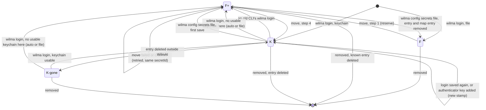
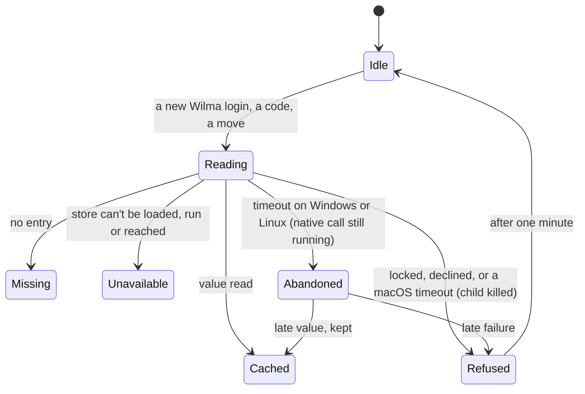
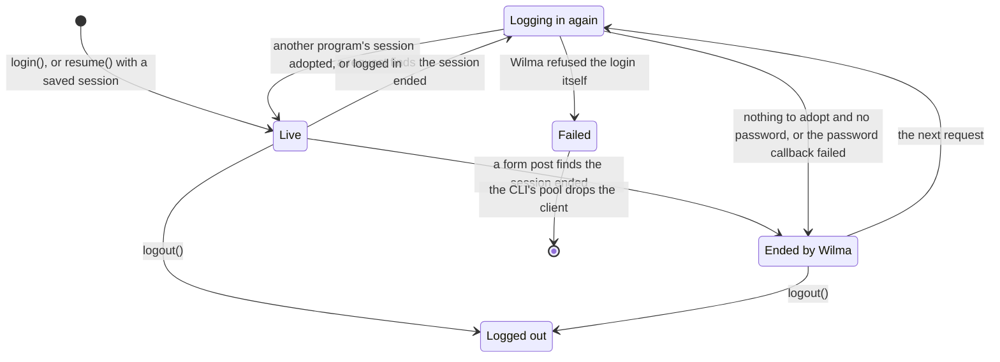

# wilma-cli: saved passwords in the OS keychain (design)

Drafted 8 November 2026 for [issue #27](https://github.com/aikarjal/wilmai/issues/27)
and revised the same day after a pressure test and a pass over its state
machines (both at the end). Not built.
Covers wilma-cli and wilma-client; WilmAI Home only where it reads the CLI's
files.

## Why, and what stays

The CLI keeps saved logins in `~/.config/wilmai/config.json`: the password
and the authenticator key scrambled (base64 with a `wilmai::` prefix), the file
readable only by the user. That was a deliberate choice, the convention of
aws, npm, kubectl and Docker without a credential helper: one file, the same
on every platform, nothing to install or unlock.

\#27 (the Parent Recap project) reports that parents who have their own AI
review the install flag the scrambled password every time. Parent Recap now
keeps the secrets in the Keychain itself and writes a temporary config for
each run.

The decision: **the file stays the default.** The keychain is an optional
backend that a program or a person turns on: Parent Recap now, WilmAI Home
later.

## Goals

1. Opt-in. Without it, nothing changes: same install, same login, same files.
2. With it, the same UX: no new steps, prompts or flags in daily use.
   **Unattended runs never wait for a person.**
3. A saved session is used without reading any credentials. The keychain is
   read only when Wilma needs a new login.
4. Logins saved earlier move over without signing in again.
5. Every program that reads the CLI's files (the CLI, the MCP server, the
   Claude Desktop extension, Home, tools like Parent Recap) can tell where a
   login's secrets are, and says clearly when it can't read them.

## Not goals

- Sessions (cookies) in the keychain. They stay in `wilmai-sessions.json`,
  owner-only. A saved session gives the same access as the password while it
  lasts (`session-store.ts` says so), so a reviewer may still flag the file;
  the README says plainly that sessions stay there. Encrypting the file with
  a key kept in the keychain is a possible later step.
- Protection from malware running as the user. Any process of the user can
  read the entry: on macOS by running `/usr/bin/security`, on Windows and
  Linux through the store's API. An agent with a shell can do the same. The
  gain is secrets kept out of files: backups, synced dotfiles, support
  pastes, file-reading agents.
- Turning it on by default (maybe later, per platform, after it has soaked).
- Moving Home's own secrets (later; section 9 says what it needs).

## How it works today

| What | Where |
| --- | --- |
| Scramble / unscramble | `config.ts` `obfuscateSecret` / `revealSecret` |
| Written | `credentials.ts` `saveLogin` (password, TOTP key); `index.ts` interactive "Save TOTP secret" |
| Read on every command | `credentials.ts` `resolveAccount` / `resolveAccounts`: every saved password is unscrambled up front; a login that can't be unscrambled is **skipped without a word** |
| Read elsewhere | `index.ts` interactive login picker; `index.ts` MFA callback; `access.ts` `endSession` (removing a login) |
| **Session key** | `agent-data.ts` `poolKey`: SHA-256 of address, username **and password**, for the session file and the in-memory pool. Home (`src/wilma/transport.ts` `sharedKeyFor`, stored with each login) and the dev bridge (`bridge/core.ts`) compute the same key |
| Login order | `verifyLoginSession`, then `adoptSession` (session saved), then `saveLogin` (`login-server.ts`, `index.ts` twice) |
| Client | wilma-client takes the password as a string and keeps it for logging in again when Wilma ends a session (`session.ts` `recover`, `canRelogin`) |
| Home reads CLI logins | `lib.rs` `cli_logins` (`has_totp` from `totpSecretObfuscated`), `cli_login_secret` (unscrambles the password) |

Two facts shape the design:

- **Finding a saved session needs the password**, because the password is in
  the session key. Goal 3 needs a key without it.
- **The session file holds an unsalted SHA-256 of each password.** While the
  scrambled password sits next to it, that adds nothing. Once the password is
  in the keychain, that hash is the weakest copy left: a weak password can
  be guessed from it offline. Keychain logins must not leave it behind.

## Design

### 1. Turning it on

The setting has three values:

| Value | New secrets go to |
| --- | --- |
| `file` (default) | the config file, as today |
| `auto` | the keychain where it can be used when the login is saved, otherwise the file, and the login page or command says which |
| `keychain` | the keychain only; saving fails when it can't be used |

- `wilma config secrets auto|keychain` turns it on, saves
  `"secretStore"` in the config and moves the saved logins (section 6).
  `wilma config secrets file` moves them back. `wilma config secrets` shows
  where each login's secrets are and whether the keychain works here;
  `--json` gives the same for tools (Parent Recap's `doctor`).
- `WILMAI_SECRET_STORE=file|auto|keychain` overrides the setting for one
  process. It only decides where **new** secrets go and never moves logins,
  so one tool can't move a family's other logins by itself.
- **The setting decides where new secrets are written. A per-login marker
  decides where existing ones are read.** A run with any setting still reads
  keychain logins.
- Tools should use `auto`. That keeps the issue's "falls back to the file
  where there is no store" (headless Linux, CI).

### 2. The saved login

```jsonc
{
  "secretStore": "auto",
  "keychainLogins": { "https://example.inschool.fi|matti": "4f0c…" },
  "profiles": [{
    "id": "https://example.inschool.fi|matti",
    "secrets": "keychain",        // absent = in this file, as today
    "secretId": "4f0c…",          // random, made when the login first goes to the keychain
    "credentialsStamp": "9a1e…",  // random, new whenever the secrets change; not secret
    "hasTotp": true,              // so listings don't need the keychain
    // passwordObfuscated / totpSecretObfuscated: absent
    …
  }]
}
```

- **One keychain entry per login**: service `ai.wilm.wilma-cli`, account
  `<secretId>`, value a JSON object `{ "password", "totpSecret" }` with
  non-ASCII escaped. One read, one possible prompt, and no half-finished Wilma
  login where the password was read but the key wasn't.
- `secretId` is random because profile ids are `tenant|username`: two config
  folders for the same account (`WILMAI_CONFIG_PATH`) would otherwise share
  one entry. It also keeps usernames out of the keychain's visible names.
- `keychainLogins` (top level) records every entry this config has made. It
  is written **before** the entry itself (section 6), so no entry exists that
  the config doesn't know about. Old CLI versions keep unknown fields when
  they save, but an old `wilma login` rebuilds the profile as a file login.
  The map lets the new CLI notice that, put the login back in the keychain
  under the same entry, and delete what the old version wrote.
- Adding an authenticator key to a keychain login (the interactive "Save
  TOTP secret") rewrites the entry with both values, sets `hasTotp` and gets
  a new `credentialsStamp`. It never writes `totpSecretObfuscated`.

### 3. The stores

**macOS: `/usr/bin/security`, no native module.** The keychain trusts the
program that created an item. An item created by `node` trusts that exact
binary, and Homebrew's `node` is ad-hoc signed: its identity is the hash of
that build, so after every `brew upgrade node` macOS asks for the Mac password
before handing the item over. Parent Recap hit exactly this in its evening
job and moved to `/usr/bin/security` (its ADR 0009). So:

- write: `/usr/bin/security -i` with the command on stdin (never on a command
  line), the value as hex (`-X`, so nothing needs quoting), `-U` to update,
  `-T /usr/bin/security` so only that program is trusted;
- read: `/usr/bin/security find-generic-password -s ai.wilm.wilma-cli -a <secretId> -w`;
- a child process with a hard timeout (killed after 10 s), so a stuck prompt
  never keeps the CLI or the MCP server waiting.

Every WilmAI program reads through the same program, so nobody is asked:
`node` from any installer, the Claude Desktop extension's Node and Home
alike. `-T /usr/bin/security` rather than `-A` (any application) keeps apps
that call the keychain directly behind macOS's prompt.

**Windows and Linux: `@napi-rs/keyring`** (2.1.2, MIT, pinned exactly) as an
**optional dependency**, loaded with `await import()` only when needed. npm
fetches only the binary for the platform (2.0 MB on Windows x64, 3.4 MB on
Linux x64); it has no install script.

- Windows Credential Manager doesn't ask per program, so there are no
  prompts. It has no credentials in some sessions (an OpenSSH login with a
  key, a scheduled task set to "Do not store password"): "can't be used".
  Entries roam with roaming profiles (Enterprise persistence; the library
  can't change it). The README says so.
- Linux: pinned to `store: "secret-service"`. The library's default falls
  back to the kernel keyring, which is in memory only and empty after a
  reboot. No Secret Service (headless, cron, WSL) = "can't be used". A locked
  keyring shows an unlock prompt on a desktop.
- A native call can't be cancelled once it has started (Node-API), and the
  Linux Secret Service waits for a prompt indefinitely. So: a timer of the
  CLI's own (`Promise.race`), **one pending read per entry** (later callers
  wait on it, no new read while it's pending), and CLI commands exit after
  reporting so an abandoned call can't keep them alive. The Linux entry is
  created lazily inside `try` (its constructor connects to D-Bus
  synchronously).

**Errors, by where they happened** (the library only gives messages):

| Kind | When |
| --- | --- |
| `unavailable` | the module or `/usr/bin/security` can't be loaded or run, no Secret Service, no Windows credentials in this session |
| `missing` | the entry isn't there (`security` exit 44, the library's `null`) |
| `refused` | anything else: locked, prompt declined, timed out |

Each process keeps one read state per entry, keyed by `secretId` and
`credentialsStamp` (machine 2 under States):

- A value read stays in memory.
- After `refused` the CLI doesn't try again for a minute, so reading several
  children doesn't show a prompt for each.
- `missing` and `unavailable` stay until the stamp changes or the process
  ends. A new `wilma login` elsewhere gives a new stamp, so a long-running
  MCP server starts fresh.
- On Windows and Linux a read that timed out may still answer later. Callers
  get `refused` meanwhile, no new read starts, and a late value is kept.

### 4. Sessions without credentials

**Session key v2** = SHA-256 of `wilmai-session-v2`, the normalized address
and the lower-cased username. No password.

- File and environment logins keep today's key (v1). Nothing changes for them.
- Keychain logins use v2 only, so the session file holds nothing derived from
  their password.
- The CLI decides the key from the saved login and passes it with the
  account, instead of `poolKey` computing it from the password.
- **The in-memory pool key** for a keychain login is v2 plus
  `credentialsStamp`. Under v1 a changed password changed the key; without
  the stamp, an MCP server started before `wilma login` saved a new password
  would keep a client holding the old one, and its next login would be
  refused (and count towards a lockout). The MCP server reads the config on
  every tool call, so it picks up the new stamp at once.
- A client that has failed for good (`auth.failed`) stays in the pool. (The
  first draft dropped it; building it showed that would retry a password
  Wilma refused on every tool call, which can lock the account. A changed
  password already gets a new pool key: v1 contains the password, and a
  keychain login's stamp changes.)
- "A changed password starts a fresh session" stays true: `wilma login`
  saves the session it just verified, which replaces the entry.

**wilma-client** (additive, 1.10.0):

- `WilmaClient.resume()` accepts the password as a string or as
  `() => Promise<string>`. `WilmaClient.login()` still takes a string.
- The callback goes in `SessionAuth.password`, the same field as the string.
  "Logged out on purpose" is encoded as that field being empty, so
  `logout()` clearing it drops the callback too. (A separate field that
  `logout()` missed would let the next request log in again and end the
  parent's browser session.) `canRelogin` and `recover` accept it.
- `recover` tries the shared session first (as today), then calls the
  callback **before** it marks the session logged out or clears the cookies.
  A successful result replaces the callback with the string, as `login()`
  already does.
- If the callback fails: a new `CredentialsUnavailableError` (with `reason`
  and `cause`; **not** a `SessionEndedError`, which means "log in again").
  The session goes to "ended by Wilma" (`loggedIn` false, `endedByWilma`
  true), so the next request tries `recover` again; never to "logged out".
  `auth.failed` is left alone: that is for Wilma refusing the login, and
  repeated refusals can lock the account.
- Also in 1.10.0: `logout()` resets `endedByWilma`. Today a client that
  Wilma had ended, and that was then logged out, still continues another
  program's saved session on its next request (`session.ts`, the request
  path). The CLI hides it by deleting the saved session when it logs out.
- The authenticator key needs no client change. The CLI reads the entry once,
  and its MFA callback uses the key from that read.

With no saved session, or one older than six hours (the usual daily run),
the CLI reads the store itself before `login()`. Both paths go through one
mapping (section 7).

### 5. Saving a login

1. Decide where the secrets go (the setting; for a login already saved, the
   rule below) and check the store can be used, **before** contacting Wilma.
   With `keychain` and no usable store, stop here: no Wilma login, no ended
   browser session, no used code.
2. Verify the login with Wilma (`verifyLoginSession`).
3. `saveLogin` writes the secrets and the profile, with a new
   `credentialsStamp`. Under `auto`, if the keychain write fails here after
   the check passed, the secrets go to the file instead and the page says
   so. Under `keychain` the save fails.
4. Only then save the verified session (`adoptSession`), under the key of
   the store chosen.

If step 3 fails, no session is left saved for a login that doesn't exist.
The login page shows the section 7 message, not the raw error.

**A login saved again** keeps its store while that store can be used here,
whatever the setting: an environment variable doesn't move it, only
`wilma config secrets file` does. If its store can't be used (a keychain
login on a computer with no usable keychain), the setting decides: `auto`
and `file` save it in the file, `keychain` fails. A keychain login whose
entry was deleted gets a new entry under the same `secretId`.

### 6. Moving logins

When the saved setting is `auto` or `keychain` (not the environment
variable), file logins are moved: by `wilma config secrets …`, and on any
later run after its command has finished and its sessions are saved
(`flushSessions`). That also catches a login an old version rewrote. For each
login (states F and F+ under States):

1. **Reserve.** Reload the config, record `keychainLogins[id]` (a new random
   `secretId`, or the one already there) and save. The login is now F+:
   still read from the file, with an entry the config knows about.
2. Read its secrets from the file. Write the keychain entry, read it back
   and compare. On Windows retry the read once: a read right after a write
   on another thread can briefly miss.
3. Copy the session entry from v1 to v2, keeping `savedAt` and `by` (Home's
   sign-in history shows `by`), and tag both entries with the login's id. A
   new session-store `copy`, because `save` resets `savedAt` and `by`.
4. Reload the config. If the login's scrambled fields changed since step 2
   (a login happened meanwhile), stop; the next run tries again. Otherwise
   change only that login's fields: `secrets`, `secretId`, `hasTotp`,
   `credentialsStamp`, and remove the scrambled fields. The login is now K.
5. Delete the v1 session entry and drop pool entries for that login.

A crash or failure before step 4 leaves the login in F+, read from the file;
the next move reuses its `secretId`. A crash between steps 4 and 5 leaves a
tagged v1 entry, which any later run deletes: for a keychain login, every
session entry tagged with its id goes, except its v2 entry. An untagged
leftover (an old Home rewrote it) goes when it expires after six hours.

A failed move is remembered in the login (`moveFailedAt`). Background moves
try again after a day, not on every run: `auto` quietly, `keychain` with one
line to stderr. The command itself always tries, and says which login failed
and why. A background move never fails the command it follows.

After the first move the command also removes stray `config.json.*.tmp` and
`wilmai-sessions.json.*.tmp` files (a crashed save leaves them with the
password in), and says once: older copies in backups or synced dotfiles still
hold the password; changing the Wilma password makes them useless.

`wilma config secrets file` moves keychain logins back and finishes F+
logins: the scrambled fields written and the marker removed in one config
save, the session entry copied back to v1, then the keychain entry deleted,
then `keychainLogins[id]` removed. A crash in between leaves F+, which
running the command again finishes. A K-gone login has nothing to read: it
stays listed and needs `wilma login`.

Interactive mode (`wilma` with no arguments) saves a config it loaded at
start. It changes to apply its edits to a fresh load, as `onStudents`
already does, so it can't turn a moved login back into a file login.

### 7. What the user sees

| Situation | Behaviour |
| --- | --- |
| Session still valid | Keychain not touched |
| Wilma ended the session, keychain fine | Read silently, new login, session saved |
| Saving with `auto`, no usable store | Saved in the file; the login page and command say so |
| Saving with `keychain`, no usable store | Stops before contacting Wilma (section 5) |
| `wilma accounts`, the login page's list | As today (`hasTotp`) |
| Environment variables set | Win, as today; the store isn't touched |

Error codes for scripts and assistants, with their own exit code:

| Code | Message (parent words) |
| --- | --- |
| `secret_missing` | The saved password for {Wilma} isn't in the keychain any more. Log in again (`wilma login`). |
| `secret_refused` | The keychain on this computer didn't hand over WilmAI's saved Wilma password. If the computer is locked or asking for a password, unlock it, then try again. |
| `secret_unavailable` | This login's password is saved in the keychain, which this copy of WilmAI can't open here. Update WilmAI, or log in again to save it where it can. |

- MCP text for `refused` and `unavailable` tells the assistant not to start a
  login: the password is saved; retyping it doesn't help.
- No message suggests environment variables. A lone `WILMA_PASSWORD` does
  nothing (environment logins need address, username and password), and the
  full set would put the password in shell history and start a separate v1
  session.

### 8. Removing

- Removing a login deletes its keychain entry after the config is saved, and
  ends its session with the v2 key: no password needed.
- `wilma config clear` reads the config leniently (it's the documented way
  out of a damaged file), always deletes the files, and deletes the entries
  of keychain logins and `keychainLogins`. It reports entries it couldn't
  delete. It never sweeps the whole service: other config folders use it.
- Nothing lists or deletes entries the config doesn't know. On macOS listing
  would read every entry. Entries left by a config deleted by hand stay; the
  README says how to remove them in Keychain Access or Credential Manager.

### 9. Other programs

- **WilmAI Home, next release (before CLI 2.5.0).**
  - Session key rule: v2 exactly when the CLI config has a keychain login for
    the same address and username, otherwise v1 as today. The key depends on
    the CLI's state, which can change while Home is open (a move). So Home
    works it out from the CLI config at **every session-file read and
    write**: `sharedSessionFor` takes the login, not a key, and Home stops
    storing the key with each login. A key fixed when the client was made
    would keep writing v1 after a move (the password hash back in the file)
    and miss the CLI's v2 saves, and the two would end each other's
    sessions. The dev bridge changes the same way.
  - A CLI keychain login: Home continues the shared session with
    `WilmaClient.resumeSession`. When it needs a new login it reads the entry:
    on macOS through `/usr/bin/security` (no prompt, no signing needed), on
    Windows with its `keyring` crate (same target name `{user}.{service}`,
    checked in both crates' source). Home never stores a typed password for a
    keychain login. If it can't read the entry, it says so and doesn't fall
    back to remembering the password.
- **Home's own secrets, later.** The same macOS route works without a
  Developer ID: items trusted by `/usr/bin/security` don't ask for the Mac
  password, signed or not.
- **Parent Recap and similar tools.** `wilma config secrets auto` once in
  setup; drop the temporary config. Their `/usr/bin/security` route matches
  section 3.
- **The Claude Desktop extension (MCPB).** It uses the same `config.json`.
  `build-mcpb.mjs` must mark `@napi-rs/keyring` as `external` (today an
  installed platform package breaks the build). macOS needs no module. The
  Windows binaries (x64 and arm64, about 2 MB each) go in the bundle's
  `node_modules` before 2.5.0 ships, so a parent with only Claude Desktop is
  never told to "reinstall with npm".
- **Older versions.** A CLI before 2.4.1 skips a login it can't read without
  a word. In a one-login family, an MCP server on an old version then thinks
  nobody is logged in and opens a login page. 2.4.1 says "this login's
  password is in the keychain; update WilmAI" instead, and section 6 repairs
  a login an old version rewrote.

### 10. Text that changes

- The login page's "saved only on this computer, in {path}"
  (`login-server.ts`) says where it actually went.
- README (saved logins; sessions stay in the file; Windows roaming; the
  libdbus licence), `cli-help.ts`, the MCPB `long_description`.

### 11. Tests

- Store: a fake backend; the error kinds; one pending read; the refusal
  pause.
- Moving: both ways; a failure at each step; a login saved by another process
  between steps 1 and 4; an old-version rewrite recovered through
  `keychainLogins`; the session entry copied with `savedAt` and `by`.
- Client: `resume` with a callback: not called while the session is valid;
  called once on a new login; failing once and then succeeding; a failure
  gives `CredentialsUnavailableError`, not `auth.failed`.
- MCP server across `wilma login` with a new password elsewhere (the stamp).
- `wilma config clear` with a damaged config.
- States:
  - a crash after each move step, then the next run (F+ finished, a tagged
    v1 leftover deleted);
  - an authenticator key added to a keychain login;
  - `logout()` followed by a request (no new login, no adopted session);
  - a Windows or Linux read that times out and answers late;
  - Home open while the CLI moves its login.
- By hand:
  - macOS: Homebrew `node` before and after an upgrade; nodejs.org `node`;
    the Claude Desktop extension; SSH into the Mac; a launchd job; a password
    with quotes, backslashes, spaces and non-ASCII.
  - Windows: a desktop session; an OpenSSH key login; a scheduled task; the
    extension with bundled binaries.
  - Linux: a desktop; a locked keyring; no Secret Service under `auto` and
    `keychain`; WSL.

### 12. Rollout

1. **wilma-cli 2.4.1**, no keychain yet: a login that can't be read is
   reported, not skipped; `external` in the MCPB build; interactive mode
   saving on a fresh load. (Built as part of 2.5.0; shipping it first only
   helps if older installs update before anyone turns the keychain on.)
2. **wilma-client 1.10.0**: the password callback, `CredentialsUnavailableError`,
   `logout()` resetting `endedByWilma`.
3. **WilmAI Home**: the session key rule, worked out at every session-file
   read and write, and CLI keychain logins (section 9).
4. **wilma-cli 2.5.0**: the stores, `wilma config secrets`, v2 keys, the new
   login order, the extension with Windows binaries, the text changes. File
   stays the default.
5. Reply on #27 with this design as the spec for the contributor's PR.

## States

Four state machines are implicit in the sections above. They are written out
here so every transition is defined, including the states a crash leaves
behind.

### Machine 1: where a login's secrets are

Kept in the config, the keychain and the session file. Any WilmAI process
can change it.

| State | `secrets` | Scrambled fields | `keychainLogins[id]` | Keychain entry | Session key |
| --- | --- | --- | --- | --- | --- |
| **F** (file) | – | yes | – | – | v1 |
| **F+** (file, entry reserved) | – | yes | yes | may exist, may hold an old password | v1 (and v2 during a move) |
| **K** (keychain) | `keychain` | – | yes | yes | v2 (and a tagged v1 until the next run, after a crash) |
| **K-gone** (entry deleted) | `keychain` | – | yes | – | v2 |

F+ covers three situations handled the same way: a move under way, a move
that crashed, and a keychain login an old CLI rewrote.



| Transition | Trigger | Guard |
| --- | --- | --- |
| F → F+ | move, step 1 | saved setting `auto` or `keychain`; for a background move, no `moveFailedAt` in the last day |
| F+ → K | move, step 4 | entry read back equal; scrambled fields unchanged since step 2 |
| F+ → F+ | a failure or crash | sets `moveFailedAt` on a failure |
| K → K | `wilma login`, an authenticator key added | keychain usable; new `credentialsStamp` |
| K → F+ | an old CLI's `wilma login` | none; the next move repairs it |
| K → K-gone | a read finds no entry (`secret_missing`) | none |
| K-gone → K | `wilma login` | keychain usable; same `secretId` |
| K, K-gone → F+ | `wilma login` | no usable keychain here, setting `auto` or `file` (with `keychain` the login fails and the state stays) |
| K → F+ → F | `wilma config secrets file` | entry readable |
| any → removed | removing the login, `wilma config clear` | none |

Invariants after every complete save:

- `secrets` set ⇔ no scrambled fields: one authoritative copy.
- `secrets` set ⇒ `keychainLogins[id]` equals `secretId`.
- Every entry WilmAI made is in some config's `keychainLogins` (written
  there first), unless that config was deleted by hand.
- A keychain login has no session entry derived from its password, apart
  from a tagged v1 entry between a crash and the next run, or an untagged one
  for at most six hours.
- `hasTotp` matches the entry, and `credentialsStamp` changes whenever the
  secrets do.

### Machine 2: reading a keychain entry (per process)

One per entry, keyed by `secretId` and `credentialsStamp`.



| State | A caller gets |
| --- | --- |
| Reading | the same pending read |
| Cached | the value, from memory |
| Missing, Unavailable | that error at once, until the stamp changes or the process ends |
| Refused, Abandoned | `refused` at once; Abandoned starts no new read, since a native call can't be cancelled |

### Machine 3: the client's session (wilma-client, in memory)

Today's `SessionAuth` fields encode it; 1.10.0 adds the callback path and
the logout fix (section 4).

| State | Fields |
| --- | --- |
| Live | `loggedIn` |
| Logging in again | `relogin` set |
| Ended by Wilma | not `loggedIn`, `endedByWilma` |
| Failed | `failed` set: every request throws it first |
| Logged out | not `loggedIn`, not `endedByWilma`, no password |



- Failed is final: only a new client leaves it, so the CLI's pool drops such
  clients.
- Logged out means "no password". `logout()` clears the password field,
  callback included, and (1.10.0) `endedByWilma`, so a logged-out client
  neither logs in again nor continues another program's session.
- A failed callback leads to Ended, never to Logged out or Failed.
- A login that fails for another reason (network, Wilma down) leaves
  `loggedIn` false with the password kept. The next request treats that like
  Ended and tries again.

### Machine 4: the session-file key (shared between programs)

Not a machine of its own: the key follows machine 1, which another process
can change at any moment.

| Login (machine 1) | Key | Written by |
| --- | --- | --- |
| F, F+, environment logins | v1 | the CLI, the MCP server and Home, as today |
| K, K-gone | v2 | the CLI and MCP server 2.5.0 and later; Home's next release |
| During a move | both, tagged with the login's id | the process moving it |

The rule: work the key out from the CLI config at every session-file read
and write, and never keep it between them. The CLI already does (the MCP
server reads the config on every tool call); Home changes to it (section 9).
Programs that know only v1 can't share a keychain login's session, so turning
the keychain on needs Home's next release and CLI 2.5.0 wherever this config
is read.

## Implementation notes (8 November 2026)

Built and tested locally (not published). What the build changed or
confirmed:

- **macOS `security -i`** takes the command on stdin and the value as hex
  (`-X`); quotes, backslashes and non-ASCII read back exactly; a failure exits
  non-zero with the reason on stderr; "not found" is exit 44.
- **Never change a macOS item in place.** `add-generic-password -U` on an
  existing item makes macOS ask for authorization to change its content: a
  dialog nobody answers in a background run. Until it's answered, that
  keychain answers everything else with "Unable to obtain authorization"
  (exit 152), while reading a missing item still answers 44. Found by the
  real-keychain test (the fakes can't show it). Saving now deletes the entry
  and adds it again, as Parent Recap's ADR 0009 does; a read that finds
  nothing in that instant tries once more before it says "missing".
- **A locked login keychain** gives the same exit 152 at once, or, when macOS
  can show its dialog, waits for it. The 10-second kill covers the second
  case. Both come out as `secret_refused`.
- **The real-keychain test on macOS** can run against a temporary keychain
  file (`WILMAI_REAL_KEYCHAIN_TEST=temp`, test hook `WILMAI_KEYCHAIN_PATH`):
  made, unlocked and deleted by the test, with the user's search list left
  alone. It checks each entry trusts `/usr/bin/security` and no `node`.
- **Background moves in the MCP server** run once when it starts, not after
  every tool call. CLI commands run them after each command.
- **The extension** (`build:mcpb`) fetches `@napi-rs/keyring` and its two
  Windows packages with `npm pack` at the pinned version: 2.6 MB in all.
- **Test hooks**, not documented for users: `WILMAI_KEYCHAIN_BACKEND`
  (`fake:<file>`, `macos`, `keyring`), `WILMAI_KEYCHAIN_SERVICE`,
  `WILMAI_KEYCHAIN_TIMEOUT_MS`.
- **The session-key rule, as built**: v2 for any login whose password isn't
  in the CLI's file (the keychain, or a store a newer WilmAI knows), v1
  otherwise. The CLI, Home and Home's dev bridge use the same rule.
- **Home** sends the login (address, username, and its v1 key when it knows
  the password) with every session-file read and write; the Rust side reads
  the CLI's config each time and picks v2 or v1. If the config exists but
  can't be read, nothing is read or written. A password typed in Home for a
  CLI keychain login signs in but isn't kept (nor a key made from it); where
  Home would have kept it, the login switches to the CLI's saved login, so
  "Stay signed in" reads the keychain. Home's Windows read path is compiled
  and unit-tested on macOS, not yet run against Credential Manager.
- **A review of the CLI and client code** found eight problems, now fixed:
  timed-out writes, deletes and checks are counted too, so a command exits
  when its output is written; interactive mode reads the config on every
  pass; the environment variable no longer moves a saved file login;
  removing a login keeps an entry it couldn't delete recorded and says so;
  `saveLogin` saves onto a fresh read after its keychain calls; the library's
  real error wording is matched; `wilma config clear` finds the entries a
  damaged config names; a move always gives a new stamp.
- **Tests**: `test/secret-store.mjs` (the CLI end to end against a fake Wilma
  and a fake keychain: moves both ways, sessions without keychain reads, the
  three errors, the login order, repairs, the read states),
  `test/mfa.mjs` (a two-step login from the keychain entry), wilma-client's
  `test/password-source.mjs`, and the opt-in `pnpm test:keychain` against
  this computer's keychain (service `ai.wilm.wilma-cli.test`).

## Validation (8 November 2026)

| Check | Result |
| --- | --- |
| macOS, the login keychain (`pnpm test:keychain`) | Passed: write, read, replace (delete and add), delete through `/usr/bin/security`; the same through `@napi-rs/keyring`; the CLI end to end (login to the keychain, saved session without a read, a new login reading it, moving back). No test items left |
| macOS, a temporary keychain (`pnpm test:keychain:temp`) | Passed, and each entry trusts `/usr/bin/security` and no `node` |
| macOS, Home reading the CLI's entry | Passed: an entry the CLI wrote (real service, random id) read by Home's Rust code, password and key intact; deleted after (`cargo test -- --ignored reads_an_entry_the_cli_wrote`) |
| Linux desktop (Docker: D-Bus, gnome-keyring unlocked) | Passed: the real-keychain test through the Secret Service, the CLI end to end, nothing left |
| Linux headless (no D-Bus session) | Passed: "no Secret Service here"; `keychain` refuses with `secret_unavailable` (exit 4) and changes nothing; `auto` keeps the file and says so |
| The CLI suite | 10 of 10 on macOS and on Linux (Docker) |
| Windows (Credential Manager; Home reading the CLI's entry with `keyring` 3.6) | Not run yet. `.github/workflows/keychain.yml` runs both on a Windows runner (by hand, or on a pull request touching the keychain code); on a Windows computer: `pnpm --filter @wilm-ai/wilma-cli test:keychain`, then `node apps/home/scripts/keychain-interop.mjs` |
| macOS, the same interop script | Passed (`node apps/home/scripts/keychain-interop.mjs`) |

## Open questions

- The command name: `wilma config secrets …` or something else.
- The exit code for the `secret_*` errors.
- A lock for config writes. Section 6 narrows the race to the moment between
  reload and rename; a lock would close it for every writer.
- Default-on later: Windows desktop sessions never ask; macOS through
  `/usr/bin/security` doesn't either.
- Considered and set aside: PowerShell (`CredRead` through `Add-Type`) on
  Windows and `secret-tool` on Linux, which would drop the native module
  entirely but add two more child-process protocols. Worth a second look if
  the optional dependency causes trouble.

## Pressure test

On 8 November 2026 three independent reviews checked the first draft:
against the code, against platform behaviour (Apple, Microsoft, freedesktop
and MCPB documentation, the libraries' source, checks on a Mac), and for
security and UX. What changed because of them:

| Finding | Change |
| --- | --- |
| **Blocker.** On macOS an item trusts the binary that created it; Homebrew's ad-hoc-signed `node` changes identity on every upgrade, so an unattended run waits for the Mac password. Confirmed on this Mac (`codesign`) and by Parent Recap's ADR 0009 | macOS goes through `/usr/bin/security` (section 3) |
| **Blocker.** The environment variable moved every login in a shared config, and the extension, shipped without the module, would then lose the family's logins | The variable never moves logins; the extension gets the binaries before 2.5.0 (sections 1, 9) |
| **Blocker.** Home's key rule was unclear: Home stores the key with each login, and v2 everywhere would end its sharing with CLI file logins | v2 exactly for CLI keychain logins, worked out at every restore (section 9) |
| A native call can't be cancelled once started, so an `AbortSignal` timeout never fires during an open prompt; retries pile up on libuv's 4 threads | Child process with a kill timeout on macOS; one pending read per entry, own timer and exit on Windows and Linux (section 3) |
| A failing callback after `recover` marked the session logged out left a long-running MCP server stuck on "not logged in" | Callback before any state change; `endedByWilma` set; test for fail-then-succeed (section 4) |
| Without the password in the key, an MCP server keeps a client with an old password after a password change | `credentialsStamp` in the pool key; failed clients dropped (section 4) |
| Old versions skip unreadable logins silently, then `wilma login` puts the password back in the file | 2.4.1 reports them; `keychainLogins` and moving on later runs repair them (sections 2, 6, 9) |
| Moving raced with other writers of the config and the session file, and `save` reset `savedAt`/`by` | Reload-and-check before the config save; session `copy`; after `flushSessions` (section 6) |
| The session was saved before the login, so a failed keychain save left a used code and an orphan session | Store checked before Wilma; session saved after the login (section 5) |
| "Set `WILMA_PASSWORD`" didn't work and would leak the password | Per-kind codes and parent-word messages; no environment advice (section 7) |
| `CredentialsUnavailableError` as a `SessionEndedError` told assistants to log in again | Own class and codes; MCP text says not to start a login (sections 4, 7) |
| Password and key as two entries: two prompts, and a half-finished login when only the second read failed | One entry per login (section 2) |
| The issue's file fallback (headless Linux, CI) was dropped | `auto` (section 1) |
| Linux's default store is in memory only; Windows has no credentials in key-authenticated SSH sessions | Pinned to Secret Service; both listed as "can't be used" (section 3) |
| Listing leftover entries reads every secret on macOS and can't tell other config folders' entries apart | No listing; only entries the config knows are deleted (section 8) |
| `wilma config clear` would fail on a damaged config | Lenient read (section 8) |
| Crashed saves leave `.tmp` files with the password; backups keep old copies | Cleaned on the first move, plus a one-line note (section 6) |
| "Any `node` script can read an item `node` created" was wrong across `node` binaries | Not goals rewritten |

Confirmed by the reviews:

- the "How it works today" table, apart from the missing dev bridge (now in);
- old versions keep unknown fields;
- per-child clients share one login, so a burst of requests calls the
  callback once;
- logout never logs in, so v2 removal needs no password;
- the tests pin v1 only for file logins;
- `node` can only use the file-based login keychain (the data-protection
  keychain needs an entitlement);
- the Windows and macOS entry names match between `keyring` 3.6 and
  `@napi-rs/keyring`, and keyring 3.6 finds `@napi-rs/keyring`'s Linux
  entries through its fallback search (a smoke test is still planned);
- one platform binary installs, with no install script.

### Second pass: state machines

Writing the states out (section States) found these gaps, now closed:

| Gap | Fix |
| --- | --- |
| A crash after the entry was written left an entry no config knew about | `keychainLogins[id]` written first (section 6, step 1) |
| A crash before the v1 session entry was deleted left the password hash, with no way to find it again | Session entries tagged with the login's id during a move (section 6) |
| Logging in again: does the setting or the marker decide? | The login keeps its store while it can be used (section 5) |
| Adding an authenticator key to a keychain login would have written it to the file | It rewrites the entry (section 2) |
| A failing background move retried, and printed, on every run | `moveFailedAt`; retried after a day (section 6) |
| Read state keyed by login would outlive a new `wilma login`; a late answer had no defined outcome | Keyed by `secretId` and stamp; a late value is kept (section 3) |
| A callback in its own field would survive `logout()` and log in again | The callback goes in the `password` field; `logout()` also resets `endedByWilma`, which today lets a logged-out client continue another program's session (section 4) |
| Home fixed the key when it made the client, so a move while Home was open broke sharing | Key worked out at every read and write (section 9) |
| Under `auto`, a keychain write failing after the check passed had no defined outcome | Saved in the file instead (section 5) |
